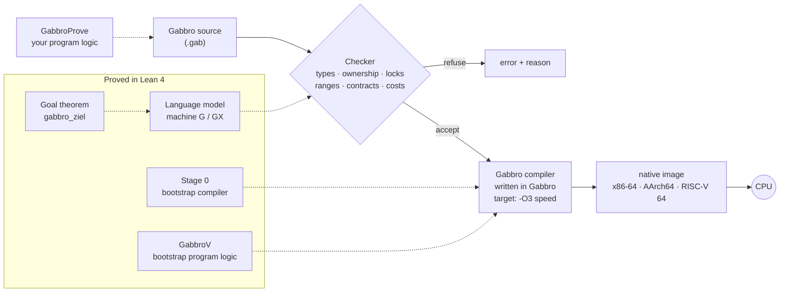

<div align="center">

<picture>
  <source media="(prefers-color-scheme: dark)" srcset="dokumente/images/logo-dark.svg">
  
</picture>

# Gabbro

**A systems programming language whose safety guarantees are theorems.**

[](LICENSE-ADDENDUM.md)
[](grammatik/lean-toolchain)
[](#check-the-proof-yourself)
[](#status)

[Example](#a-first-program) · [Getting started](#getting-started) · [Status](#status) · [How it works](#how-it-works) ·
[Roadmap](#roadmap) · [FAQ](#faq) · [Docs](#documentation) · [Contribute](#get-involved)

</div>

In most languages you write a program and hope your tests catch what's wrong with it. Gabbro asks for a little more up
front — what each function reads and writes, which locks it needs, which range each number lives in — and in return the
checker either accepts your program or tells you why it won't.

For every program the language's checker accepts, one theorem proved in Lean, the *goal theorem*, says what holds: no
memory errors, no data races, no lock deadlocks, contracts and cost bounds kept. You prove only what is specific to your
program and name the hardware assumptions you rely on. Today the theorem is about the language as defined in Lean;
between your source text and the theorem stands the Lean parser and elaborator, whose faithfulness is trusted, not
yet proved. [What is and is not claimed](#what-is-and-is-not-claimed) says exactly how far it reaches.

- **Prove less.** The language carries memory, races, locks, ranges and costs. You prove what your program is
  *supposed* to compute — today in GabbroV, later in GabbroProve.
- **As fast as C.** The target is at least the speed of the faster of `gcc -O3` and `clang -O3` on equivalent C, per
  workload and architecture. Nothing is measured yet, so nothing is claimed yet.
- **No checks you don't need.** Inside a program every index, size and range is proved by the checker, so by design
  the compiled code carries no bounds or size checks. Data from outside — program arguments, system calls, devices,
  foreign code — is checked once, where it comes in.
- **No `unsafe`.** No integer → pointer casts either. Code from outside the language (`extern fn`) enters only behind a
  named assumption, and the old inline-`asm` form is being replaced by checked target-binding calls, so that device
  access becomes checked authority too.
- **Refuse, never warn.** What the checker can decide, it decides at compile time. What it can't decide, it refuses.

> [!IMPORTANT]
> **There is no usable Gabbro compiler yet, and that is intended at this stage.** Today there is the language, defined
> in Lean with its goal theorem proved, and **Stage 0**, a bootstrap compiler written in Lean whose only job is to build
> Gabbro's real compiler, which is to be written in Gabbro. Stage 0 is not meant for writing software: it emits an
> intermediate representation for a test runner, not native executables.

## A first program

Four counters behind a lock, each of which must never go past 100. (The syntax looks like Rust, but ranges differ:
`a .. b` *includes* `b`, and `a ..< b` excludes it.)

```rust
// The README example: a lock-protected counter with a range-checked increment; exits 42.
module counter {

table hits count 4 { slot { n : u32 in 0 .. 100, } }   // four slots, each value from 0 to 100
lock L protects { hits } rank 0;                          // hits may only be touched under L

impl fn bump(i : u32 in 0 ..< 4)
    effects { reads hits.slots, writes hits.slots }       // every access is declared
    requires Held(L)                                      // callers must hold L
{
    let c : u32 in 0 .. 100 = hits.slots[i].n;
    if c < 100 {
        hits.slots[i].n = c + 1;                          // the checker proves c + 1 <= 100
    }
}

impl fn main() -> u32 in 0 .. 255
    effects { reads hits.slots, writes hits.slots, locks L }
{
    locks L {
        bump(2);
        bump(2);
        return hits.slots[2].n + 40;                      // exit code 42
    }
}

}
```

This one is accepted and exits with `42`. Now break it in two small ways: call `bump` outside `locks L { … }`, or
loosen the guard to `if c <= 100`, so that `c + 1` could reach 101. Both are refused before anything runs. This is the
bootstrap compiler's real output, unedited (run from `stage0/`). Stage 0's checker is meant to be exactly the
theorem's checker; proving that is [gate R1](#roadmap).

```console
$ .lake/build/bin/stage0 --ir proben-ir/readme-counter-unlocked.gab out.img
stage0: call without held guard
stage0: note: elaboration: function main: call without held guard (statement 1 of 2: call bump) [declared at proben-ir/readme-counter-unlocked.gab:17] [statement at proben-ir/readme-counter-unlocked.gab:20]

$ .lake/build/bin/stage0 --ir proben-ir/readme-counter-overflow.gab out.img
stage0: value outside range
stage0: note: function bump: value outside range [declared at proben-ir/readme-counter-overflow.gab:7]
```

Stage 0's messages are terse — the second one points at `bump`'s declaration (line 7), not at the `c + 1` on line 13.

In Rust you would get the first guarantee by putting the counters in a `Mutex`. For the second, Rust has no built-in
compile-time check: `c <= 100` compiles, and the counter that was meant to stop at 100 holds 101. In Gabbro both mistakes are
refused.

All three versions live in [`stage0/proben-ir/`](stage0/proben-ir/) (`readme-counter*.gab`), so the repository's
acceptance check confirms that the first exits with 42 and the other two are refused with these two errors. There's more to read in
[`examples/`](examples/) (177 programs), [`examples/poison/`](examples/poison/) (829 programs written to be refused)
and the grammar in [SYNTAX.md](dokumente/SYNTAX.md).

## Getting started

**What you need:**

- [elan](https://github.com/leanprover/elan), or `nix develop` with the repository's flake. Checking the proof works
  wherever Lean runs; running Stage 0's output needs x86-64 Linux.
- About 20 GB of disk (measured: Mathlib 7.4 GB, the language model 8.9 GB, Stage 0 1.6 GB).
- 32 GB of RAM recommended. The build caps each Lean process at 16 GB; with less RAM use `LEAN_NUM_THREADS=1` and
  expect that it may not fit.
- Time: there are no prebuilt binaries. The full language model takes about 30 minutes at 3 threads (measured);
  Stage 0 takes by our estimate another 1–2 hours. Later builds are incremental.

We clone `dev`, the working branch, because the example above lives there. `dev` is pushed without a build gate and
may occasionally be red; `master` only moves to a commit on which every package builds and both guardians pass (last
time on 2026-11-13, before this example existed).

### Check the proof yourself

This is the heart of the project, so start here. You don't have to take this README's word for anything: rebuild the
goal theorem and print the axioms it rests on.

```bash
git clone -b dev https://github.com/SimonVitzethum/Gabbro && cd Gabbro/grammatik
lake exe cache get                                   # precompiled Mathlib, ~7 GB
LEAN_NUM_THREADS=3 lake build \
  Grammatik.Zielsatz.Kern.Beweis Grammatik.Zielsatz.Kern.Erfuellbarkeit \
  Grammatik.Zielsatz.Atomar.BeweisAtomar Grammatik.Zielsatz.Atomar.Erfuellbarkeit \
  Grammatik.Zielsatz.Atomar.BeweisTerminierung Grammatik.Zielsatz.Atomar.BeweisWarten
lake env lean NachpruefungZiel.lean
```

After three long `#check` signatures you should see 14 lines like this one, each listing at most these three axioms:

```text
'Gabbro.Grammatik.Zielsatz.gabbro_ziel' depends on axioms: [propext, Classical.choice, Quot.sound]
```

A `sorryAx` in that list would mean something isn't proved. What the axiom list can't tell you is whether the
*statement* is the right one. That's [`Spec.lean`](grammatik/Grammatik/Zielsatz/Kern/Spec.lean): its header is the
single list of named assumptions and of what is **not** claimed, and it wins wherever any other text, this README
included, disagrees.

### Optional: watch the bootstrap toolchain at work

To see the example accepted, refused and run,
build Stage 0 and its runner (from `Gabbro/grammatik`, where the previous step ended):

```bash
cd ../stage0
LEAN_NUM_THREADS=3 lake build stage0                 # first time: 1–2 h
mkdir -p .lake/ir && (cd runner && lake exe runner ../.lake/ir)
chmod +x .lake/ir/runner

.lake/build/bin/stage0 --ir proben-ir/readme-counter.gab counter.img
.lake/ir/runner counter.img; echo $?                 # → 42
```

`counter.img` is an S0IR image, not a native executable; the runner executes it. On a refusal, `stage0` exits with `1`
and prints the reason. Stage 0 is tested on the 542 programs in `stage0/proben-ir/`; the programs in `examples/`
exercise the whole language, and many of them are not accepted by Stage 0 yet.

## Status

*As of 2026-11-20, branch `dev`. Last fully gated state: `master` at `4355d5b0b` (2026-11-13).*

| Component | Directory | State |
|---|---|---|
| **Language model and goal theorem** | [`grammatik/`](grammatik/) | Proved on the three standard axioms. Its premises are proved satisfiable, so it is not vacuously true. |
| **Stage 0** — bootstrap compiler | [`stage0/`](stage0/) | Written in Lean and kept as the permanent bootstrap, it compiles most of the userspace language to S0IR so that Gabbro's own compiler can be built. 506 of 542 IR probes behave as expected (2026-11-20); the other 36 are valid programs whose contracts Stage 0's checker cannot decide yet, and none is miscompiled. |
| **Runner** — bootstrap executor | [`stage0/runner/`](stage0/runner/) | Executes S0IR images on x86-64. Its bytes are generated by Lean and proved against a Lean model of x86-TSO; that the model matches real CPUs is tested, not proved. `runner.s` is a listing Lean writes from those bytes, not handwritten source. |
| **Native floats** | [`grammatik/nativefloat/`](grammatik/nativefloat/) | `f32`/`f64` run on CPU instructions under one named hardware assumption. |
| **GabbroV** — bootstrap program logic | [`programmlogik/`](programmlogik/) | Written in Lean; proves the passes of the Gabbro compiler and, until GabbroProve exists, your own program's duties. In progress: the bridge to the language model carries 13 of about 31 statement forms so far (gate R2). Stays in use as the bootstrap. |
| **GabbroProve** | — | **Planned.** The program logic written natively in Gabbro, for fast proofs of your program's logic. GabbroV stays as its bootstrap. |
| **The Gabbro compiler** | — | **Not started.** Written in Gabbro, always built through Stage 0; native code for x86-64, AArch64 and RISC-V 64 through target tables, every optimisation pass proved, with the speed of `gcc -O3`/`clang -O3` as the target. It begins once the gates below are met. |

Also not there yet: a checker you can run that is identical to the one in the theorem; a proved bridge that carries
cost bounds, ownership and the concurrent guarantees down to the bytes; a standard library (programs bring their own
`syscall` bindings); full source-to-IR coverage in Stage 0.

## How it works



The Gabbro compiler, written in Gabbro, is what is being built. It is always bootstrapped from the Lean side: **Stage 0**
builds it and **GabbroV** proves its passes, and both stay in use for every build instead of being retired, so that a
random error in one compiler generation can never carry over into the next. Your own program logic is proved in
**GabbroProve**, written natively in Gabbro so that logic proofs run fast.

The **goal theorem** reads: if **(a)** the checker accepts the program, **(b)** your duties hold, **(c)** the named
hardware assumptions hold and **(d)** the runtime starts what is declared, then every reachable machine state is safe —
memory, ownership, races, locks, contracts, invariants and cost bounds. The checker decides (a); you own (b) and choose (c);
(d) is today an assumption about the loader and the runtime, to be proved once Gabbro has its own runtime (R5). Next to it stand separate theorems for linking, liveness, termination and waiting bounds.

Every guarantee comes from a theorem about *all* programs. Nothing rests on a proof about one particular program or on
checking one compiler run after the fact. There is no `sorry` and no `native_decide`, and the project's rule is that
no unverified fast path is ever added.

**The bootstrap chain.** Stage 0 compiles the Gabbro compiler, and it keeps doing so for every build rather than
handing over to a self-compiled predecessor. Stage 0 is being proved too, so that no build of the real compiler rests on an
unchecked tool. Its lowering already has a generic theorem: for every image Stage 0 emits, the runner model ends with
the result of the program's sequential run in the language model, or with the same stop code, given stated conditions
on the runner and the image. Gate R3 extends this to the whole goal theorem on every image — race freedom, invariants, ownership and cost bounds — and gate R1 proves Stage 0's checker equal to the
one in the theorem.

<details>
<summary><b>Glossary</b></summary>

| Term | Meaning |
|---|---|
| **Machine G / GX** | The formal semantics of Gabbro in Lean: G for one thread, GX for concurrent runs. |
| **Goal theorem** (`gabbro_ziel`) | The single statement of what the language promises. |
| **Checker** | The acceptance rules of the language; in the theorem, the Lean function `AkzeptiertX`. |
| **Stage 0** | The bootstrap compiler, written in Lean. |
| **S0IR** | Stage 0's intermediate representation, executed by the runner. |
| **Duty** | A proof obligation about *your* program's logic that the language can't carry for you, proved in GabbroV today and in GabbroProve later. |
| **GabbroV / GabbroProve** | The program logic: GabbroV is the permanent bootstrap in Lean, GabbroProve the fast native version in Gabbro. |
| **Named assumption** | A premise nobody can prove (for example, that the CPU behaves like its model), listed in `Spec.lean`. |
| **Probe** | A test program with an expected exit code or an expected refusal. |

Several directory and module names are German: `Zielsatz` = goal theorem, `Beweis` = proof, `Nachpruefung` =
re-check, `proben` = probes, `programmlogik` = program logic, `bruecke` = bridge. The file names of the example programs
are still German too (`0001-tabelle.gab` = table, `0004-schleifen.gab` = loops, …).

</details>

## What is and is not claimed

| ✅ True today | ❌ Not true yet |
|---|---|
| "The goal theorem is proved over the Lean model, with its non-degeneracy proved." | "Gabbro is verified." |
| "For every image Stage 0 emits, a generic theorem carries the result of the sequential run to the runner model." | "This binary is verified." |
| "The runner's bytes are proved against a Lean model of x86-TSO." | "The compiler is verified end to end." |
| | "The parser and elaborator are proved to preserve the meaning of the source." |

The right-hand column becomes true only when the checker and compiler in the theorem are the ones you actually run and
the bridge down to the bytes is complete. Calling a Gabbro artifact verified comes with a condition; see
[License](#license).

## Roadmap

| Gate | Goal | State |
|---|---|---|
| **R1** Bootstrap complete | every form the sources of GabbroV and of the compiler need compiles through Stage 0 with a generic theorem; the IR corpus is green; Stage 0's checker is proved equal to the theorem's | in progress — 506 of 542 IR probes pass |
| **R2** GabbroV ready | proof duties generated for every Stage-0 form | in progress |
| **R3** Trusted bootstrap output | the goal holds on every image Stage 0 emits | in progress |
| **R4** Low-level model | addresses, device registers, privileged operations, interrupts — **no assembly, no `unsafe`** | in progress |
| **R5** Kernel ready | the compiler emits freestanding images; a kernel written in Gabbro boots on x86-64 | not started |

Work on the Gabbro compiler itself starts once R1–R3 and the syntax of R4 are done. The details and the critical path
are in [PLAN-COMPILER-READY.md](dokumente/PLAN-COMPILER-READY.md); the longer horizon — information flow, constant
time, isolation, real time, probabilistic guarantees — is in [PLAN-LONG-RANGE.md](dokumente/PLAN-LONG-RANGE.md).

## FAQ

<details>
<summary><b>Can I use Gabbro today?</b></summary>

Not for real work. There's no release compiler, no standard library, and the guarantees reach a compiled image only
in part. What you can do today is read the language, check the proof, and run small programs through the bootstrap
toolchain to see what gets accepted and what gets refused.
</details>

<details>
<summary><b>Why not just use Stage 0 as the compiler?</b></summary>

Because it was never meant to be one. Stage 0 is written in Lean so that its lowering can be proved, it emits an IR
for a test runner rather than native code, and it is deliberately simple. The compiler Gabbro will ship is written in
Gabbro, optimises to the speed of `gcc -O3`/`clang -O3`, targets three architectures, and has every pass proved. Stage 0 stays
the starting point of every build of that compiler.
</details>

<details>
<summary><b>How does it differ from Rust, Dafny, F* or Verus?</b></summary>

Rust's type system gives you memory safety but stops at `unsafe` and says nothing about contracts or cost. Dafny, F\*
and Verus can prove far more than Gabbro's checker decides, at the price of writing specifications and proofs
yourself. Gabbro sits between them: a fixed, decidable set of properties — memory, races, locks, ranges, contracts in a
decidable fragment, costs — that the checker decides for every program, so you owe no proof for them; one theorem that
says what acceptance means; and a separate program logic (GabbroV today, GabbroProve later) for what is specific to your program.
</details>

<details>
<summary><b>Why Lean 4?</b></summary>

The language model, the checker in the theorem, Stage 0 and the runner's bytes all live in one proof assistant, so the
proofs connect without translating between tools. Mathlib supplies the mathematics.
</details>

<details>
<summary><b>What is a "named assumption"?</b></summary>

Something nobody can prove: that a CPU behaves like its model, that firmware or a host OS keeps its declared contract,
that a random source is random. Gabbro never hides these. Each one has a name, appears in the `Spec.lean` header,
and the contracts of foreign code and devices are in force only for a program that declares such items (the
native-float assumption is currently a premise for every program).
</details>

<details>
<summary><b>Which platforms?</b></summary>

The bootstrap toolchain runs on x86-64 Linux. The Gabbro compiler is planned for x86-64, AArch64 and RISC-V 64 from the
start: a new target is a target table and a binding, never a change to sources, IR, passes or proofs.
</details>

<details>
<summary><b>Why the name?</b></summary>

Gabbro is a dark, coarse-grained rock that forms deep in the Earth's crust, under much of the ocean floor. A language
meant to sit underneath kernels and compilers should be made of something like it.
</details>

## Documentation

| Read this | To learn |
|---|---|
| [LANGUAGE.md](dokumente/LANGUAGE.md) | the language and its guarantees |
| [SYNTAX.md](dokumente/SYNTAX.md) | the grammar, form by form |
| [Spec.lean](grammatik/Grammatik/Zielsatz/Kern/Spec.lean) | the exact goal statement and its named assumptions |
| [THEOREM-MAP.md](dokumente/THEOREM-MAP.md) | where each guarantee is proved |
| [IR-COMPILATION-LANES.md](dokumente/IR-COMPILATION-LANES.md) | which forms Stage 0 compiles |
| [GABBROV.md](dokumente/GABBROV.md) | how you prove your own program's logic |
| [LOW-LEVEL-SYNTAX-PLAN.md](dokumente/LOW-LEVEL-SYNTAX-PLAN.md) | kernels and drivers without assembly |

<details>
<summary><b>Repository layout</b></summary>

```text
grammatik/              Lean model of the language, goal theorem (Zielsatz/), parser and elaborator
  nativefloat/          native floating-point boundary
stage0/                 Stage 0, the bootstrap compiler (Lean), and its probes (proben/, proben-ir/)
  runner/               the proved x86-64 runner that executes S0IR
programmlogik/          GabbroV: the bootstrap program logic
  bruecke/              bridge from GabbroV to machine G
  passlogik/            the checker's pass logic as Lean theorems
examples/               example programs
  poison/               programs written to be refused
dokumente/              language reference, syntax, plans, theorem map
instrumente/            the two guardians that gate the master branch
```
</details>

## Get involved

- **Questions, ideas, bugs:** open an [issue](https://github.com/SimonVitzethum/Gabbro/issues).
- **Soundness bugs are the most valuable thing you can report:** a program the checker accepts although it breaks a
  guarantee, a statement in `Spec.lean` that says less than its name or comment claims, or premises that can't hold
  together. The smallest `.gab` file or Lean snippet that shows it helps most.
- **Contributing code:**
  1. A language change starts in the Lean model, then moves to the checker, the compiler and the docs.
  2. No guarantee is ever weakened to make a build green; no `sorry`, `native_decide` or `unsafe`, and no `axiom` outside the reviewed
     allow-list.
  3. Lean files stay below 500 lines, and every new module is imported from a package root.
  4. Commits follow [Conventional Commits](https://www.conventionalcommits.org/). Work lands on `dev`; `master` moves
     only when both guardians (`instrumente/abnahme.py`) are green.

  The full rules are in [AGENTS.md](AGENTS.md) §1–§5 and §8.

## License

[AGPL-3.0](LICENSE) with an [addendum](LICENSE-ADDENDUM.md): **programs you write in Gabbro, and everything a Gabbro
compiler makes of them, are yours under any license you like.** If you present such an artifact as formally
verified, proved or secure, that permission holds only while it carries the notice "Generated by Gabbro" with a link to
this repository, so anyone can look up what that guarantee rests on.
