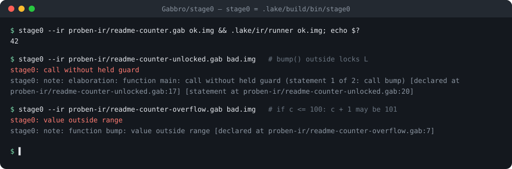
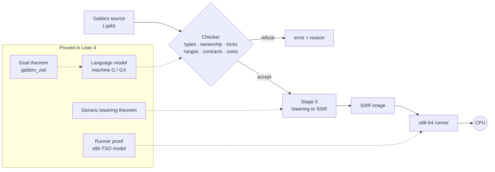

<div align="center">


[](LICENSE-ADDENDUM.md)
[](grammatik/lean-toolchain)
[](#verify-the-goal-theorem)
[](#status)

[Example](#a-first-program) · [Quickstart](#quickstart) · [Verify](#verify-the-goal-theorem) · [Status](#status) ·
[How it works](#how-it-works) · [Roadmap](#roadmap) · [FAQ](#faq) · [Docs](#documentation) · [Contribute](#get-involved)

</div>

**Gabbro is a systems programming language whose safety guarantees are theorems.** Your code states what it reads
and writes, which locks it takes and which range each number stays in. The compiler either accepts the program or
tells you why not — and for the language as defined in Lean, one proved theorem says that every accepted program is
memory-safe, race-free and keeps its locks, contracts and cost bounds, under hardware assumptions you name.

<p align="center"></p>

- **Prove less.** You prove only what is specific to your program — its functional correctness — and name the
  hardware assumptions you rely on. Everything else is the language's job.
- **No escape hatch.** No `unsafe`, no integer → pointer casts, no assembly; even device access is checked authority.
- **Refuse, never warn.** What the checker can decide it decides at compile time; what it cannot decide is refused.

> [!WARNING]
> **Research prototype — not for production use.** The theorem is proved over the Lean model; the first compiler
> runs real programs but carries only part of the guarantees down to the binary. See [Status](#status) and
> [what may be claimed](#what-is-and-is-not-claimed).

## A first program

```rust
module counter {

table hits count 4 { slot { n : u32 in 0 .. 100, } }   // four slots, each value provably in 0..=100
lock L protects { hits } rank 0;                          // hits may only be touched under L

impl fn bump(i : u32 in 0 ..< 4)
    effects { reads hits.slots, writes hits.slots }       // every access is declared
    requires Held(L)                                      // callers must hold L
{
    let c : u32 in 0 .. 100 = hits.slots[i].n;
    if c < 100 {
        hits.slots[i].n = c + 1;                          // the checker proves c + 1 <= 100
    }
}

impl fn main() -> u32 in 0 .. 255
    effects { reads hits.slots, writes hits.slots, locks L }
{
    locks L {
        bump(2);
        bump(2);
        return hits.slots[2].n + 40;                      // exit code 42
    }
}

}
```

It compiles and exits with `42`. The terminal above shows the two ways to break it: call `bump` outside
`locks L { … }`, or weaken the guard to `if c <= 100` so that `c + 1` can reach 101. Both stop at compile time.

In Rust you would get the first guarantee by moving the counters into a `Mutex`; the second has no compile-time
type, so `c <= 100` compiles and stores 101 in a counter that was meant to stop at 100. In Gabbro both are refused at compile
time, and for the programs it accepts the goal theorem states what holds.

All three programs are probes in [`stage0/proben-ir/`](stage0/proben-ir/) (`readme-counter*.gab`), so the master
gate re-checks this section. More: 177 examples in [`beispiele/`](beispiele/), 829 programs written to be refused in
[`beispiele/gift/`](beispiele/gift/), and the grammar in [SYNTAX.md](dokumente/SYNTAX.md).

## Quickstart

**Requirements:** x86-64 Linux, [elan](https://github.com/leanprover/elan) (or `nix develop` with the repository's
flake), 16 GB of RAM (estimate, at 3 build threads), ~20 GB of disk (Mathlib 7.4 GB, language model 8.9 GB, Stage 0 1.6 GB, measured). There are no
prebuilt binaries yet: the first build compiles the Lean model of the language — about 30 minutes for the model alone
at 3 threads, measured, and by estimate 1–2 hours with Stage 0. Later builds are incremental.

```bash
# 1. Get the sources and the precompiled Mathlib (~7 GB)
git clone -b dev https://github.com/SimonVitzethum/Gabbro && cd Gabbro/grammatik
lake exe cache get

# 2. Build the Stage-0 compiler and write the runner binary   (first time: 1–2 h)
cd ../stage0
LEAN_NUM_THREADS=3 lake build stage0
mkdir -p .lake/ir && (cd ../runner && lake exe runner ../stage0/.lake/ir)
chmod +x .lake/ir/runner

# 3. Compile and run the example                              (seconds)
.lake/build/bin/stage0 --ir proben-ir/readme-counter.gab counter.img
.lake/ir/runner counter.img; echo $?        # → 42
```

On a refusal, `stage0` exits with `1` and prints the reason. To try your own program, pass its `.gab` file instead of
the probe.

## Verify the goal theorem

You don't have to trust this README: rebuild the proof and print its axioms. This reuses what the quickstart built;
on its own it needs Mathlib plus at most the 8.9 GB of the language model.

```bash
cd ../grammatik           # from Gabbro/stage0, where the quickstart ended
LEAN_NUM_THREADS=3 lake build \
  Grammatik.Zielsatz.Kern.Beweis Grammatik.Zielsatz.Kern.Erfuellbarkeit \
  Grammatik.Zielsatz.Atomar.BeweisAtomar Grammatik.Zielsatz.Atomar.Erfuellbarkeit \
  Grammatik.Zielsatz.Atomar.BeweisTerminierung Grammatik.Zielsatz.Atomar.BeweisWarten
lake env lean NachpruefungZiel.lean
```

Expected for `gabbro_ziel` — and for every other named statement, at most these three axioms:

```text
'Gabbro.Grammatik.Zielsatz.gabbro_ziel' depends on axioms: [propext, Classical.choice, Quot.sound]
```

A `sorryAx` in that list would mean a statement is not proved. The axiom list cannot tell you whether the *statement*
is the right one: that is [`Spec.lean`](grammatik/Grammatik/Zielsatz/Kern/Spec.lean), whose header is the single list
of named assumptions and of what is **not** claimed. It wins wherever any other text, this README included, disagrees.

## Status

*As of 2026-11-20 (branch `dev`).*

| Component | Directory | State |
|---|---|---|
| **Language model and goal theorem** | [`grammatik/`](grammatik/) | Proved on the three standard axioms; its premises are proved satisfiable, so it is not vacuous. |
| **Stage 0 compiler** | [`stage0/`](stage0/) | Compiles the userspace language to the IR S0IR. 37 of 542 IR probes still fail — **all as refusals**, none with a wrong result. |
| **x86-64 runner** | [`runner/`](runner/) | Runs S0IR images. Its bytes are generated by Lean and proved against a Lean model of x86-TSO; that the model matches the CPU is tested differentially, not proved. `runner/runner.s` is a listing Lean writes from those bytes, not handwritten source. |
| **Native floats** | [`nativefloat/`](nativefloat/) | `f32`/`f64` run on CPU instructions under one named hardware assumption. |
| **GabbroV** | [`programmlogik/`](programmlogik/), [`bruecke/`](bruecke/) | The program logic in which a user proves their own program's duties. |

**Not there yet:** a self-hosted compiler; a deployed checker identical to the one in the theorem; a proved bridge
that carries cost bounds, ownership and the concurrent guarantees down to the image; a standard library (programs
bring their own `syscall` bindings); full source-to-IR coverage; AArch64 and RISC-V 64 (planned as target tables, not
source changes).

## How it works



The **goal theorem** reads: if **(a)** the checker accepts the program, **(b)** the user's duties hold, **(c)** the
named hardware assumptions hold and **(d)** the runtime starts what is declared, then every reachable machine state
is safe — memory, ownership, races, locks, contracts, invariants and cost bounds. The language owns (a) and (d); you
own (b) and choose (c). Beside it stand theorems for linking, liveness, termination and waiting bounds.

Every guarantee comes from a theorem over *all* programs: no guarantee rests on a per-program proof or on translation
validation, and there is no `sorry`, no `native_decide` and no unverified fast path.

<details>
<summary><b>Glossary</b></summary>

| Term | Meaning |
|---|---|
| **Machine G / GX** | The formal semantics of Gabbro in Lean: G for one thread, GX for concurrent runs. |
| **Goal theorem** (`gabbro_ziel`) | The single statement of what the language promises. |
| **Checker** | The acceptance rules of the language; in the theorem, the Lean function `AkzeptiertX`. |
| **Stage 0** | The first compiler, written in Lean, from Gabbro to S0IR. |
| **S0IR** | Stage 0's intermediate representation, executed by the runner. |
| **Duty** | A proof obligation about *your* program logic that the language cannot carry, discharged in GabbroV. |
| **Named assumption** | A premise nobody can prove (e.g. that the CPU behaves like its model), listed in `Spec.lean`. |
| **Probe** | A test program with an expected exit code or an expected refusal. |

Several directory and module names are German: `Zielsatz` = goal theorem, `Beweis` = proof, `Nachpruefung` =
re-check, `beispiele` = examples, `gift` = poison (programs that must be refused), `proben` = probes.

</details>

## What is and is not claimed

| ✅ May be said | ❌ May not be said (yet) |
|---|---|
| "The goal theorem is proved over the Lean model, with its non-degeneracy proved." | "Gabbro is verified." |
| "Stage 0's lowering carries the result of a single-threaded run to the image, by a generic theorem." | "This binary is verified." |
| "The runner's bytes are proved against a Lean model of x86-TSO." | "The compiler is verified end to end." |

The second column becomes true only when the checker and compiler in the theorem are the deployed ones and the
bridge down to the bytes is complete. Anyone who presents a Gabbro artefact as verified must say where that guarantee
comes from ([license addendum](LICENSE-ADDENDUM.md)).

## Roadmap

| Gate | Goal | State |
|---|---|---|
| **R1** Stage 0 complete | every form the compiler's own sources need compiles through Stage 0 | in progress — 37 IR probes refused |
| **R2** GabbroV ready | proof duties generated for every Stage-0 form | in progress |
| **R3** Trusted output | the goal holds on every image Stage 0 emits | in progress |
| **R4** Low-level model | addresses, device registers, privileged operations, interrupts — **no assembly, no `unsafe`** | in progress |
| **R5** Kernel ready | the compiler emits freestanding images; a kernel written in Gabbro boots on x86-64 | not started |

The compiler written in Gabbro starts once R1–R3 and the syntax of R4 are done. Details and the critical path:
[PLAN-COMPILER-READY.md](dokumente/PLAN-COMPILER-READY.md). Longer horizon — information flow, constant time,
isolation, real time, probabilistic guarantees: [PLAN-LONG-RANGE.md](dokumente/PLAN-LONG-RANGE.md).

## FAQ

<details>
<summary><b>Can I use Gabbro today?</b></summary>

For experiments, yes: Stage 0 compiles and runs real userspace programs on x86-64 Linux. For anything you depend
on, no — there is no standard library, the compiler covers only part of the language, and the guarantees reach the
compiled image only partially (see [Status](#status)).
</details>

<details>
<summary><b>How does it differ from Rust, Dafny, F* or Verus?</b></summary>

Rust's type system carries memory safety but stops at `unsafe` and says nothing about contracts or cost. Dafny, F\*
and Verus can prove much more than Gabbro's checker decides, at the price of writing specifications and proofs
yourself. Gabbro aims between them: a fixed, decidable set of properties — memory, races, locks, ranges, contracts in
a decidable fragment, costs — that the checker decides for every program without user proofs, a single theorem that
says what acceptance means, and a separate program logic (GabbroV) only for what is specific to your program.
</details>

<details>
<summary><b>Why Lean 4?</b></summary>

The language model, the checker in the theorem, the Stage-0 compiler and the runner's bytes all live in one proof
assistant, so the proofs connect without translation between tools. Mathlib supplies the mathematics.
</details>

<details>
<summary><b>What is a "named assumption"?</b></summary>

Something nobody can prove — that a CPU behaves like its model, that firmware or a host OS keeps its declared
contract, that a random source is random. Gabbro never hides these: each one has a name, appears in the `Spec.lean`
header, and is chosen by the program that relies on it.
</details>

<details>
<summary><b>Which platforms?</b></summary>

x86-64 today. AArch64 and RISC-V 64 are designed in from the start: a new target is a target table and a binding,
never a change to sources, IR, passes or proofs.
</details>

## Documentation

| Read this | To learn |
|---|---|
| [LANGUAGE.md](dokumente/LANGUAGE.md) | the language and its guarantees |
| [SYNTAX.md](dokumente/SYNTAX.md) | the grammar, form by form |
| [Spec.lean](grammatik/Grammatik/Zielsatz/Kern/Spec.lean) | the exact goal statement and its named assumptions |
| [THEOREM-MAP.md](dokumente/THEOREM-MAP.md) | where each guarantee is proved |
| [IR-COMPILATION-LANES.md](dokumente/IR-COMPILATION-LANES.md) | which forms Stage 0 compiles |
| [GABBROV.md](dokumente/GABBROV.md) | how a user proves their own program logic |
| [LOW-LEVEL-SYNTAX-PLAN.md](dokumente/LOW-LEVEL-SYNTAX-PLAN.md) | kernels and drivers without assembly |

<details>
<summary><b>Repository layout</b></summary>

```text
grammatik/       Lean model of the language, goal theorem (Zielsatz/), parser and elaborator
stage0/          Stage-0 compiler (Lean) and its probe corpora (proben/, proben-ir/)
runner/          proved x86-64 runner for S0IR
nativefloat/     native floating-point boundary
programmlogik/   GabbroV: program-logic model
bruecke/         bridge from GabbroV to machine G
beispiele/       example programs (gift/: programs that must be refused)
dokumente/       language reference, syntax, plans, theorem map
instrumente/     the two guardians that gate the master branch
```
</details>

## Get involved

- **Questions, ideas, bugs:** open an [issue](https://github.com/SimonVitzethum/Gabbro/issues).
- **Soundness bugs are the most valuable report:** a program the checker accepts although it breaks a guarantee, a
  statement in `Spec.lean` that says less than its name or comment claims, or premises that cannot hold together.
  Please include the smallest `.gab` file or Lean snippet that shows it.
- **Contributing code:**
  1. A language change starts in the Lean model, then the checker, the compiler and the docs.
  2. No guarantee is ever weakened to make a build green; no `sorry`, `axiom`, `native_decide` or `unsafe`.
  3. Lean files stay below 500 lines; every new module is imported from a package root.
  4. Commits follow [Conventional Commits](https://www.conventionalcommits.org/); work lands on `dev`, and `master`
     advances only when both guardians (`instrumente/abnahme.py`) are green.

  The full rules are in [AGENTS.md](AGENTS.md) §1–§5 and §8.

## License

[AGPL-3.0](LICENSE) with an [addendum](LICENSE-ADDENDUM.md): **programs you write in Gabbro, and everything the
compiler makes of them, are yours under any license you like.** The one condition: if you present such an artefact
as formally verified, proved or secure, it must carry a notice saying it was generated by Gabbro and where that
guarantee comes from.
